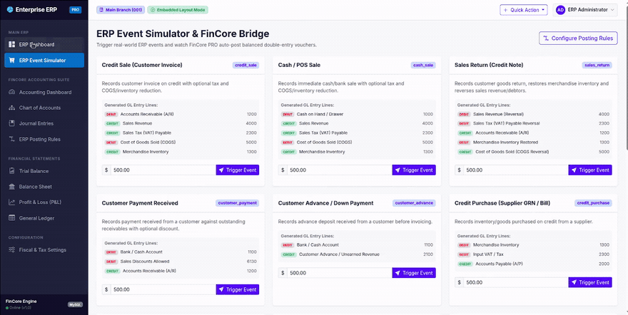

# NML FinCore

NML FinCore is a robust, decoupled double-entry accounting engine designed for Laravel applications. It enables real-time ledger generation, polymorphic linking to transactional models, multi-SBU reporting, and strict period locks.

---

## 💖 NML FinCore PRO (Commercial UI Kit & ERP Auto-Posting Engine)

Looking for a **Ready-Made QuickBooks-style Accounting Dashboard, Live Drill-Down Reports, and Zero-Accounting-Knowledge ERP Event Bridge**?

Check out **[NML FinCore PRO](https://github.com/Premod1/nml-fincore-pro)**!

<p align="center">
  
</p>

### 🌟 What's in FinCore PRO?
* **Full QuickBooks Online (QBO) UI Suite**: Chart of Accounts, Journal Voucher Manager, Trial Balance, Profit & Loss, Balance Sheet, and General Ledger.
* **Zero-Accounting-Knowledge Event Bridge (`FinCorePro::recordErpEvent`)**: Record Sales, Payments, Bills, and Expenses directly from ERP controllers without calculating Debits, Credits, VAT, or COGS!
* **Dynamic ERP Posting Rules UI (`/accounting/settings`)**: Accountants can dynamically re-map accounts from the browser without code changes.
* **Dual-Mode Integration**: Embeds seamlessly into your existing Bootstrap 4/5 or Blade ERP layout via Scoped CSS (`.fincore-scope`).

### 🚀 Get FinCore PRO ($29 Sponsor Tier)
Sponsor **$29** on [GitHub Sponsors (Premod1)](https://github.com/sponsors/Premod1) to receive instant private repository access, automated collaborator invitation, and all future updates:

👉 **[Sponsor & Get FinCore PRO ($29)](https://github.com/sponsors/Premod1)**

Once sponsored, install via Composer:
```json
"repositories": [
    {
        "type": "vcs",
        "url": "https://github.com/Premod1/nml-fincore-pro.git"
    }
],
"require": {
    "nml/fincore-pro": "^1.0"
}
```

---

## Installation

Install the package via Composer:

```bash
composer require nml/fincore
```

### Migration Setup

The package migrations will be loaded automatically. Run the database migrations to create the necessary tables:

```bash
php artisan migrate
```

### Configuration (Optional)

Publish the configuration file to customize the table prefix, rounding tolerance, currency, and period locks:

```bash
php artisan vendor:publish --tag=fincore-config
```

---

## Core Feature List

* **Double-entry accounting engine**: Enforces exact balance matching for debit and credit lines within a configurable rounding tolerance.
* **Dynamic chart of accounts**: Classifies and rolls up accounts hierarchically under Assets, Liabilities, Equity, Revenue, and Expenses with parent-child relationship support.
* **Real-time general ledger generation**: Generates real-time ledger entries and balances.
* **Trial Balance reporting**: Dynamic Trial Balance generation based on date range and SBU codes.
* **Balance Sheet reporting**: Dynamic Balance Sheet generation showing Assets, Liabilities, and Equity.
* **Income Statement (P&L)**: Dynamic Profit & Loss reporting based on Revenue and Expense accounts.
* **Cash Flow statements**: Automatically generated Cash Flow statements based on account movements.
* **Multi-SBU / branch reporting**: Tracks entries using Strategic Business Unit (SBU) codes for departmental or branch-level accounting.
* **Fiscal period locking**: Prevents retrospective postings or modifications to closed accounting periods and years.
* **Polymorphic transaction linking**: Links journal entries directly to external source models (Invoices, Sales, Purchases, Payments).
* **Multi-currency support**: Supports transactions in foreign currencies with exchange rates.
* **Tax/VAT handling**: Enforces tax rules, inclusive/exclusive calculations, and automated tax line generation.
* **Fixed asset management**: Fixed asset register with purchase cost and accumulated depreciation tracking.
* **Automated depreciation posting**: Automatically calculates and posts monthly straight-line depreciation entries.
* **Budgeting & variance reporting**: Sets monthly budget targets per account and generates Budget vs. Actual variance reports.
* **Bank reconciliation matching**: Automatically matches bank statement transactions with ledger lines and supports manual clearing.
* **AR/AP ageing reports**: Tracks partner receivables and payables with FIFO payment allocation and ageing buckets.
* **Fiscal year closing engine**: Automatically zero-out temporary Revenue/Expense accounts and transfers Net Profit/Loss to Retained Earnings.
* **Full audit trail & activity logging**: Automatically logs all creations, updates, status transitions, and deletions, capturing user ID, IP address, user agent, and JSON diffs.

---

## Initialization

Seed the standard Chart of Accounts using the provided seeder or calling the initializer class directly:

### Option A: Using Laravel Database Seeder
Add the package seeder class to your main `database/seeders/DatabaseSeeder.php` file:

```php
public function run(): void
{
    $this->call(\Nml\FinCore\Database\Seeders\FinCoreSeeder::class);
}
```

Or run it directly from the terminal:

```bash
php artisan db:seed --class="Nml\FinCore\Database\Seeders\FinCoreSeeder"
```

### Option B: Programmatic Initialization
You can seed the standard Chart of Accounts programmatically (e.g., in a tenant setup flow or custom script):

```php
use Nml\FinCore\Services\ChartOfAccountsInitializer;

// Seeds the default chart of accounts (idempotent, safe to rerun)
ChartOfAccountsInitializer::initialize('LKR');
```

### Chart of Accounts Management

To create and manage custom accounts (including parent-child hierarchies), use the `Account` model:

#### Creating a Root Account
```php
use Nml\FinCore\Models\Account;
use Nml\FinCore\Enums\AccountType;

$assetsParent = Account::create([
    'code' => '1000',
    'name' => 'Assets',
    'type' => AccountType::ASSET->value,
    'subtype' => 'asset',
    'parent_id' => null, // Root account
]);
```

#### Creating a Sub-Account (Child Account)
Link it to its parent by passing the parent's `id`:
```php
$bankAccount = Account::create([
    'code' => '1100',
    'name' => 'Seylan Bank A/C',
    'type' => AccountType::ASSET->value,
    'subtype' => 'current_asset',
    'parent_id' => $assetsParent->id, // Linked to the parent account
]);
```

---

## Usage Scenarios

### 1. Creating and Posting a Journal Entry

Create a journal entry as a draft, validate it, and post it to the General Ledger.

```php
use Nml\FinCore\Facades\FinCore;
use Nml\FinCore\Enums\JvType;

// Create the journal entry draft
$entry = FinCore::createJournalEntry([
    'date' => '2026-06-18',
    'reference' => 'INV-2026-0001',
    'type' => JvType::GENERAL->value,
    'description' => 'Credit sale invoice registration',
    'sbu_code' => 'COLOMBO_SBU',
    'journalable_type' => 'App\Models\Invoice', // Optional polymorphic model link
    'journalable_id' => 45,
    'lines' => [
        [
            'account_id' => 3, // Accounts Receivable (Asset)
            'type' => 'debit',
            'amount' => 50000.00,
            'description' => 'Debit A/R for customer invoice'
        ],
        [
            'account_id' => 20, // Sales Revenue (Revenue)
            'type' => 'credit',
            'amount' => 50000.00,
            'description' => 'Credit Sales Revenue'
        ]
    ]
]);

// Post to General Ledger (Performs balance matching & period lock checks)
try {
    $entry->post();
} catch (\Nml\FinCore\Exceptions\AccountingException $e) {
    // Handle validation errors (e.g., Unbalanced Debits/Credits or Closed Period)
    Log::error($e->getMessage());
}
```

#### 1.1. Creating a Manual Journal Voucher (JV)
For manual journal adjustments entered by accountants via a voucher UI, collect the form inputs (rows with Account, Type, Debit/Credit, and optional Notes) and post them directly:

```php
use Nml\FinCore\Facades\FinCore;
use Nml\FinCore\Enums\JvType;

// Map the dynamic rows of a manual JV interface to the lines array:
$entry = FinCore::createJournalEntry([
    'date' => '2026-06-18',
    'reference' => 'JV-2026-0045',
    'type' => JvType::GENERAL->value,
    'description' => 'Manual adjustment for prepaid rent',
    'lines' => [
        [
            'account_id' => 12, // Prepaid Expense Account
            'type' => 'debit',
            'amount' => 15000.00, // Debit amount from Row 1
            'description' => 'Amortization of rent'
        ],
        [
            'account_id' => 25, // Rent Expense Account
            'type' => 'credit',
            'amount' => 15000.00, // Credit amount from Row 2
            'description' => 'Corresponding rent credit'
        ]
    ]
]);

// Post to ledger
$entry->post();
```

#### Parameter Details

* **`type`**: Indicates the category of the journal entry. Developers should use the `Nml\FinCore\Enums\JvType` enum:
  * `JvType::GENERAL->value` (`'general'`): Normal business transactions (e.g., sales invoices, supplier purchases, payments).
  * `JvType::ADJUSTMENT->value` (`'adjustment'`): End-of-period adjustments (e.g., depreciation, accruals, prepayments).
  * `JvType::CLOSING->value` (`'closing'`): Year-end closing entries to reset revenue/expense balances to the retained earnings account.
* **`sbu_code`**: Strategic Business Unit (Branch, Department, or Division) code. Tagging entries with this code enables department-wise or branch-wise filtering on all financial statements.
* **`journalable_type` & `journalable_id`**: Polymorphic relationship columns that map this journal entry to the source document in the ERP (e.g., `App\Models\Invoice` or `App\Models\Payment`). This provides an audit trail back to the originating business transaction.

### 2. Generating a Trial Balance

Generate a Trial Balance report within a specific date range or filter by SBU.

```php
use Nml\FinCore\Facades\FinCore;

$trialBalance = FinCore::getTrialBalance(
    startDate: '2026-01-01',
    endDate: '2026-06-30',
    sbuCode: 'COLOMBO_SBU' // Optional SBU filter
);

// Format of the returned array:
// [
//     'accounts' => [
//          ['account' => AccountModel, 'debit' => 50000.00, 'credit' => 0.00, 'balance' => 50000.00],
//          ...
//      ],
//     'total_debits' => 50000.00,
//     'total_credits' => 50000.00,
//     'is_balanced' => true
// ]
```

### 3. Generating an Income Statement (Profit & Loss)

Get the revenue, expense, and net income metrics for a specified period.

```php
use Nml\FinCore\Facades\FinCore;

$incomeStatement = FinCore::getIncomeStatement(
    startDate: '2026-04-01',
    endDate: '2026-06-30'
);

$netIncome = $incomeStatement['net_income'];
$totalRevenue = $incomeStatement['revenue']['total'];
$totalExpenses = $incomeStatement['expenses']['total'];
```

### 4. Generating a Balance Sheet

Generate the statement of financial position as of a specific date.

```php
use Nml\FinCore\Facades\FinCore;

$balanceSheet = FinCore::getBalanceSheet(
    date: '2026-06-18'
);

$assets = $balanceSheet['assets']['total'];
$liabilities = $balanceSheet['liabilities']['total'];
$equity = $balanceSheet['equity']['total'];
$currentYearEarnings = $balanceSheet['current_year_earnings']; // Net profit/loss dynamically rolled into equity if fiscal year is unclosed
$isBalanced = $balanceSheet['is_balanced']; // Assets = Liabilities + Equity
```

### 5. Generating a General Ledger (Account Ledger)

Generate a detailed General Ledger report for a specific account, supporting memory-efficient pagination for large datasets:

```php
use Nml\FinCore\Facades\FinCore;

$ledger = FinCore::getGeneralLedger(
    accountId: 3, // Accounts Receivable
    startDate: '2026-01-01',
    endDate: '2026-06-30',
    sbuCode: 'COLOMBO_SBU',
    perPage: 50,  // Optional pagination limit
    page: 1       // Optional page number
);

foreach ($ledger['accounts'] as $accountReport) {
    $account = $accountReport['account']; // Account model instance
    $openingBalance = $accountReport['opening_balance'];
    $closingBalance = $accountReport['closing_balance'];
    
    // Pagination metadata (only returned if perPage is specified)
    $pagination = $accountReport['pagination'] ?? null;
    
    foreach ($accountReport['entries'] as $entry) {
        $entryNumber = $entry['entry_number'];
        $date = $entry['date'];
        $type = $entry['type']; // 'debit' or 'credit'
        $amount = $entry['amount'];
        $runningBalance = $entry['running_balance'];
    }
}
```

### 6. Generating a Cash Flow Statement

Generate a Cash Flow statement (indirect method) for a date range:

```php
use Nml\FinCore\Facades\FinCore;

$cashFlow = FinCore::getCashFlowStatement(
    startDate: '2026-01-01',
    endDate: '2026-06-30'
);

$operatingTotal = $cashFlow['operating_activities']['total'];
$investingTotal = $cashFlow['investing_activities']['total'];
$financingTotal = $cashFlow['financing_activities']['total'];
$netIncreaseDecrease = $cashFlow['net_increase_decrease'];
$beginningCash = $cashFlow['beginning_cash'];
$endingCash = $cashFlow['ending_cash'];
$isReconciled = $cashFlow['is_reconciled']; // true if beginningCash + netIncreaseDecrease matches endingCash
```

### 7. Managing Entry Statuses

Transitions draft entries to submitted, and void or reject them:

```php
// Submit for review
$entry->submit($userId);

// Reject and send back to draft
$entry->returnToDraft('Reason for rejection');

// Void posted journal entry
$entry->void();
```

### 8. Advanced: Tax/VAT & Multi-Currency

#### Registering a Tax Rate
Create a tax rate mapping it to a general ledger account for tax postings:

```php
use Nml\FinCore\Models\Tax;

$vatTax = Tax::create([
    'name' => 'VAT 15%',
    'code' => 'VAT-15',
    'rate' => 15.00,
    'account_id' => 15, // Output VAT Payable account ID
    'is_active' => true
]);
```

#### Creating a Multi-Currency Entry with Automatic Tax Calculation
When creating a foreign currency transaction with tax:
1. Provide the `currency` (e.g. `'USD'`) and `exchange_rate` (e.g. `300.000000`).
2. Provide `fc_amount` (Foreign Currency amount) on lines. The system automatically computes the functional currency `amount = fc_amount * exchange_rate`.
3. Provide `tax_id` and `tax_behavior` (`'inclusive'` or `'exclusive'`). The system calculates the tax and automatically creates the corresponding tax ledger entry.

```php
use Nml\FinCore\Facades\FinCore;
use Nml\FinCore\Enums\JvType;

$entry = FinCore::createJournalEntry([
    'date' => '2026-06-18',
    'reference' => 'TX-USD-001',
    'type' => JvType::GENERAL->value,
    'description' => 'Foreign sale invoice with tax',
    'currency' => 'USD',
    'exchange_rate' => 300.000000,
    'lines' => [
        [
            'account_id' => 3, // Accounts Receivable (Asset)
            'type' => 'debit',
            'fc_amount' => 115.00, // Total USD including tax
            'description' => 'A/R for foreign sale'
        ],
        [
            'account_id' => 20, // Sales Revenue (Revenue)
            'type' => 'credit',
            'fc_amount' => 115.00,
            'tax_id' => $vatTax->id,
            'tax_behavior' => 'inclusive', // Tax amount (15 USD / 4500 LKR) is extracted and posted to Output VAT
            'description' => 'Sales revenue inclusive of VAT'
        ]
    ]
]);

// Post to ledger. Validates balancing in both USD (115.00) and LKR (34500.00).
$entry->post();
```

#### Period-End Unrealized Forex Revaluation Engine
In multi-currency accounting (IAS 21), foreign-currency denominated monetary balances (Bank accounts, Accounts Receivable, Accounts Payable, short/long-term debt) must be revalued at period-end closing exchange rates. Non-monetary accounts (such as Merchandise Inventory, Fixed Assets, Prepayments, and Equity) are strictly excluded from revaluation.

FinCore provides automated period-end revaluation calculations, automated adjusting journal entry generation (unrealized gain/loss), and automatic reversing entry generation on the first day of the subsequent fiscal period:

```php
use Nml\FinCore\Facades\FinCore;

// 1. Preview / calculate revaluation without writing entries to the database
$preview = FinCore::calculateForexRevaluation(
    asOfDate: '2026-06-30',
    closingRates: [
        'USD' => 320.000000,
        'EUR' => 345.500000,
    ]
);

// Returns itemized details, total_gain, total_loss, and net_gain_loss:
// [
//     'as_of_date'    => '2026-06-30',
//     'total_gain'    => 20000.0,
//     'total_loss'    => 4000.0,
//     'net_gain_loss' => 16000.0,
//     'items'         => [ ... ]
// ]

// 2. Perform automated revaluation and post adjusting journal entries
$result = FinCore::revalueForexBalances(
    asOfDate: '2026-06-30',
    closingRates: [
        'USD' => 320.000000,
        'EUR' => 345.500000,
    ],
    autoReverse: true, // Automatically generates reversing entry on 1st day of next period
    reversalDate: null // Optional: defaults to next fiscal period start date or next day
);

// $result contains:
// - 'journal_entries': array of posted revaluation adjusting entries
// - 'reversal_entries': array of posted reversing entries
// - 'journal_entry': primary revaluation entry
// - 'reversal_entry': primary auto-reversal entry

// 3. Manual reversal of an existing revaluation entry (if autoReverse was false):
$reversal = FinCore::reverseForexRevaluationEntry(
    entry: $result['journal_entry'],
    reversalDate: '2026-07-01'
);
```

### 9. Fixed Assets & Depreciation

#### Registering a Fixed Asset
Register a fixed asset with purchase costs, depreciation parameters, and its target ledger accounts:

```php
use Nml\FinCore\Models\FixedAsset;

$asset = FixedAsset::create([
    'name' => 'Delivery Van',
    'code' => 'FA-VAN-001',
    'purchase_date' => '2026-01-01',
    'purchase_cost' => 2400000.00,
    'salvage_value' => 400000.00,
    'useful_life_years' => 5,
    'depreciation_method' => 'straight_line', // 'straight_line' or 'reducing_balance'
    'depreciation_rate' => 20.00, // 20% annual rate
    'asset_account_id' => 5, // Motor Vehicles cost account
    'accumulated_depreciation_account_id' => 6, // Accumulated Depreciation account
    'depreciation_expense_account_id' => 25, // Depreciation Expense account
    'status' => 'active'
]);
```

#### Calculating and Posting Depreciation
Calculate monthly depreciation for a specific asset or all active assets, which automatically creates and posts the corresponding double-entry journal:

```php
use Nml\FinCore\Facades\FinCore;

// 1. Calculate the monthly depreciation amount for a specific asset
$amount = FinCore::calculateMonthlyDepreciation($asset, '2026-06-30');

// 2. Post depreciation for a specific asset (Creates Debit Depreciation Expense, Credit Accumulated Depreciation)
$entry = FinCore::postDepreciationForAsset($asset->id, '2026-06-30');

// 3. Post monthly depreciation for all active fixed assets in bulk
$results = FinCore::postDepreciationForAllActiveAssets('2026-06-30');
```

---

### 10. Budgeting & Variance Reporting

#### Setting Monthly Budget Targets
Set a target monthly budget amount for a specific account and SBU:

```php
use Nml\FinCore\Facades\FinCore;

$budget = FinCore::setMonthlyBudget(
    accountId: 25, // Depreciation Expense account
    year: 2026,
    month: 6,
    amount: 40000.00,
    sbuCode: 'COLOMBO_SBU' // Optional
);
```

#### Generating a Budget vs. Actual Variance Report
Fetch target budgets, actual ledger movements, and variance details for a specific month:

```php
use Nml\FinCore\Facades\FinCore;

$report = FinCore::getBudgetVarianceReport(
    year: 2026,
    month: 6,
    sbuCode: 'COLOMBO_SBU' // Optional
);

foreach ($report as $row) {
    $accountName = $row['account_name'];
    $budgetAmount = $row['budget_amount'];
    $actualAmount = $row['actual_amount'];
    $variance = $row['variance']; // Positive is Favorable, Negative is Unfavorable
    $variancePercentage = $row['variance_percentage'];
    $status = $row['status']; // 'Favorable' or 'Unfavorable'
}
```

---

### 11. Bank Reconciliation Matcher

#### Starting a Bank Reconciliation Statement
Create a bank reconciliation session for a specific bank ledger account, date, opening and closing balance:

```php
use Nml\FinCore\Facades\FinCore;

$reconciliation = FinCore::createReconciliation(
    accountId: 1, // Bank Account
    statementDate: '2026-06-30',
    openingBalance: 150000.00,
    closingBalance: 185000.00
);
```

#### Fetching Unreconciled Ledger Lines
Get all posted journal entry lines for this account that remain uncleared:

```php
use Nml\FinCore\Facades\FinCore;

$unreconciled = FinCore::getUnreconciledLines(
    accountId: 1,
    endDate: '2026-06-30'
);
```

#### Running the Auto-Matcher
Match uploaded bank statement transactions against unreconciled ledger entries automatically. The engine matches based on exact amount, type (debit/credit), and transaction date differences:

```php
use Nml\FinCore\Facades\FinCore;

$statementTransactions = [
    ['date' => '2026-06-10', 'amount' => 5000.00, 'type' => 'debit', 'reference' => 'TXN-1'],
    ['date' => '2026-06-15', 'amount' => 30000.00, 'type' => 'credit', 'reference' => 'TXN-2'],
];

$results = FinCore::autoMatchStatementTransactions(
    reconciliationId: $reconciliation->id,
    statementTransactions: $statementTransactions
);

$matched = $results['matched'];     // List of successfully matched items
$unmatched = $results['unmatched']; // List of bank statement items not found in ledger
```

#### Manual Clear and Finalization
Reconcile lines manually or finalize the statement. Finalization requires the cleared balance to match the statement closing balance perfectly:

```php
use Nml\FinCore\Facades\FinCore;

// Manually clear a ledger line
FinCore::manuallyClearLine($reconciliation->id, $lineId = 42, '2026-06-25');

// Finalize and close the reconciliation statement
FinCore::finalizeReconciliation($reconciliation->id);
```

---

### 12. Accounts Receivable (AR) & Accounts Payable (AP) Ageing Reports

#### Recording Entries with Partner Metadata
To track receivables and payables per customer or vendor, pass the polymorphic `partnerable` object and optional `due_date` when creating double-entry records:

```php
use Nml\FinCore\Facades\FinCore;

// Create sales invoice entry with partner tracking
$entry = FinCore::createJournalEntry([
    'date' => '2026-06-01',
    'reference' => 'INV-2026-001',
    'lines' => [
        [
            'account_id' => 3, // Accounts Receivable (Receivable type)
            'type' => 'debit',
            'amount' => 120000.00,
            'due_date' => '2026-06-30',
            'partnerable_type' => 'App\Models\Customer',
            'partnerable_id' => 105,
            'description' => 'Sales invoice for Customer #105'
        ],
        [
            'account_id' => 20, // Sales Revenue
            'type' => 'credit',
            'amount' => 120000.00
        ]
    ]
]);
$entry->post();
```

#### Generating Ageing Reports
Fetch the ageing analysis report for all partners. The engine allocates credits against debits using a FIFO (First In, First Out) algorithm and classifies outstanding amounts into age buckets based on the `due_date`:

By default, the engine tracks Accounts Receivable using code `1200` (or accounts with subtype `receivable`) and Accounts Payable using code `2000` (or accounts with subtype `payable`). You can customize these codes in `config/accounting.php` (`ar_account_codes` and `ap_account_codes`) or pass specific account IDs directly.

```php
use Nml\FinCore\Facades\FinCore;

// 1. Get Accounts Receivable Ageing Report (Default configured AR accounts)
$arReport = FinCore::getReceivablesAgeingReport('2026-06-30');

// 2. Get Accounts Payable Ageing Report (Default configured AP accounts)
$apReport = FinCore::getPayablesAgeingReport('2026-06-30');

// 3. (Optional) Filter by specific Account IDs
$customArReport = FinCore::getReceivablesAgeingReport('2026-06-30', [$arAccountId]);
$customApReport = FinCore::getPayablesAgeingReport('2026-06-30', [$apAccountId]);

foreach ($arReport as $row) {
    $partnerName = $row['partner_name'];
    $totalOutstanding = $row['total_outstanding'];
    $current = $row['current'];       // Not due yet
    $bucket1 = $row['1_30'];          // 1 - 30 days overdue
    $bucket2 = $row['31_60'];         // 31 - 60 days overdue
    $bucket3 = $row['61_90'];         // 61 - 90 days overdue
    $bucket4 = $row['91_plus'];       // 91+ days overdue
}
```

---

### 13. Fiscal Year-End Closing Engine

#### Closing a Fiscal Year
At the end of a fiscal year, close the year by calling `closeFiscalYear`. The engine automatically:
1. Calculates the net balance of all Revenue and Expense accounts for that year.
2. Generates and posts a closing journal entry on the last day of the fiscal year, transferring the net profit or loss to the specified Retained Earnings account.
3. Sets the balance of all Revenue and Expense accounts to zero relative to the next period.
4. Marks the `FiscalYear` and all its monthly `FiscalPeriod`s as closed, locking them against future postings or modifications.

```php
use Nml\FinCore\Facades\FinCore;

// Close Fiscal Year ID 1, transferring net profit/loss to Retained Earnings Account ID 8
$closingEntry = FinCore::closeFiscalYear(
    fiscalYearId: 1,
    retainedEarningsAccountId: 8,
    userId: 1 // Optional user ID of the approver
);
```

---

### 14. Audit Trail / Activity Log

#### Retrieving Audit History
The engine automatically logs all creations, updates, state changes (`submitted`, `posted`, `voided`), and deletions of journal entries. This includes capturing the actor's user ID, IP address, user agent, action type, and a JSON diff of modified attributes (`old_values` vs `new_values`).

Retrieve the history for any journal entry:
```php
use Nml\FinCore\Facades\FinCore;

$logs = FinCore::getAuditHistory($journalEntryId);

foreach ($logs as $log) {
    Log::info("Action: " . $log->action);
    Log::info("Performed by User: " . $log->user_id);
    Log::info("IP: " . $log->ip_address);
    Log::info("User Agent: " . $log->user_agent);
    Log::info("Old State: ", (array) $log->old_values);
    Log::info("New State: ", (array) $log->new_values);
}
```

---

### 15. Recurring & Scheduled Journal Entries Engine

Automate recurring journal vouchers for subscriptions, lease amortizations, rent, prepayment recognition, and interest accruals. Supports fixed amounts, dynamic formulas, configurable frequencies, iteration tracking, expiration dates, and automated Artisan command processing.

#### Creating a Recurring Journal Entry Template

```php
use Nml\FinCore\Facades\FinCore;

// 1. Fixed-amount recurring entry (e.g. Monthly Office Rent)
$recurringRent = FinCore::createRecurringEntry([
    'name'           => 'Monthly Office Rent',
    'code'           => 'REC-RENT',
    'frequency'      => 'monthly',    // 'daily', 'weekly', 'monthly', 'quarterly', 'annually', 'custom'
    'interval'       => 1,            // Every 1 month
    'start_date'     => '2026-01-01',
    'end_date'       => '2026-12-31', // Optional expiration date
    'max_iterations' => 12,           // Optional iteration limit
    'auto_post'      => true,         // Automatically post to GL, or false to create drafts
    'lines_template' => [
        [
            'account_id'  => 18, // Rent Expense
            'type'        => 'debit',
            'amount'      => 75000.00,
            'description' => 'Office Rent for {month_name} {year} ({iteration}/{max_iterations})',
        ],
        [
            'account_id'  => 2,  // Bank Account
            'type'        => 'credit',
            'amount'      => 75000.00,
            'description' => 'Rent Payment - {month_name} {year}',
        ],
    ],
]);

// 2. Dynamic formula-based recurring entry (e.g. Prepaid Insurance Amortization)
$prepaymentAmortization = FinCore::createRecurringEntry([
    'name'           => 'Prepaid Insurance Amortization',
    'code'           => 'AMORT-INS',
    'frequency'      => 'monthly',
    'start_date'     => '2026-01-01',
    'max_iterations' => 12,
    'auto_post'      => true,
    'metadata'       => [
        'total_amount' => 120000.00,
    ],
    'lines_template' => [
        [
            'account_id'     => 19, // Insurance Expense
            'type'           => 'debit',
            'amount_formula' => 'total_amount / max_iterations', // Evaluates to 10,000/month
            'description'    => 'Monthly Insurance Amortization - Month {iteration}/{max_iterations}',
        ],
        [
            'account_id'     => 5,  // Prepaid Expenses
            'type'           => 'credit',
            'amount_formula' => 'total_amount / max_iterations',
            'description'    => 'Amortization offset',
        ],
    ],
]);
```

#### Processing Recurring Entries Programmatically

```php
// Process all recurring entries that are due as of a specific date:
$result = FinCore::processDueRecurringEntries('2026-06-01');

// Process a single specific recurring entry:
$entry = FinCore::processRecurringEntry($recurringRent, runDate: '2026-06-01');
```

#### Processing via Artisan CLI and Task Scheduler

Run the artisan command to process all due recurring entries:

```bash
php artisan fincore:process-recurring
```

Options:
```bash
# Process entries due as of a specific reference date
php artisan fincore:process-recurring --date=2026-06-01

# Process a specific recurring entry by ID
php artisan fincore:process-recurring --id=5 --force
```

In your Laravel application's `routes/console.php` (or `app/Console/Kernel.php`), schedule it to run automatically daily:

```php
use Illuminate\Support\Facades\Schedule;

Schedule::command('fincore:process-recurring')->dailyAt('00:05');
```

---

### 16. Multi-Level Journal Entry Approval Workflow (Maker-Checker)

Enforce enterprise internal financial controls, maker-checker segregation of duties, and role-based monetary approval thresholds.

#### Status Lifecycle
```
DRAFT ➔ PENDING_APPROVAL ➔ APPROVED ➔ POSTED
                     └───► REJECTED (with mandatory reason)
```

#### Configuration & Role Resolver (Method 1: Hooking Host ERP System)
Configure approval thresholds in `config/accounting.php`, and hook your host ERP application's User & Role system (such as Spatie Laravel Permission or custom RBAC) via the `role_checker` callback:

```php
// config/accounting.php
'approval_workflow' => [
    'enabled' => env('ACCOUNTING_APPROVAL_WORKFLOW_ENABLED', true),
    'enforce_maker_checker' => env('ACCOUNTING_ENFORCE_MAKER_CHECKER', true),

    // Method 1: Hook ERP's user/role system
    'role_checker' => function ($userId, string $requiredRole): bool {
        $user = \App\Models\User::find($userId);
        return $user ? $user->hasRole($requiredRole) : false;
    },

    // Amount-based approval thresholds
    'thresholds' => [
        [
            'level'      => 1,
            'max_amount' => 50000.00,
            'role'       => 'accountant',
        ],
        [
            'level'      => 2,
            'max_amount' => 500000.00,
            'role'       => 'finance_manager',
        ],
        [
            'level'      => 3,
            'max_amount' => null, // Over 500,000 LKR
            'role'       => 'cfo',
        ],
    ],
],
```

You can also register or override the role checker dynamically in a service provider or middleware:
```php
use Nml\FinCore\Facades\FinCore;

FinCore::setRoleChecker(function ($userId, $requiredRole) {
    return \App\Models\User::find($userId)?->hasRole($requiredRole) ?? false;
});
```

#### Submitting, Approving, and Rejecting Entries

```php
use Nml\FinCore\Facades\FinCore;

// 1. Maker creates a draft journal entry
$entry = FinCore::createJournalEntry([
    'date'        => '2026-06-01',
    'created_by'  => $makerId,
    'description' => 'Supplier payment voucher',
    'lines'       => [ ... ],
]);

// 2. Submit for approval
$entry->submitForApproval(userId: $makerId);
// Status is now 'pending_approval'

// 3. Check if current logged-in user can approve (Maker-Checker check + Threshold check)
if (FinCore::canApproveJournalEntry($entry, userId: $approverId)) {
    // 4. Approve entry
    FinCore::approveJournalEntry(
        entry: $entry,
        approverId: $approverId,
        comment: 'Verified with vendor invoice'
    );
    // Status is now 'approved'

    // 5. Post to General Ledger
    $entry->post();
    // Status is now 'posted'
} else {
    // Or reject with mandatory reason
    FinCore::rejectJournalEntry(
        entry: $entry,
        approverId: $approverId,
        reason: 'Missing tax invoice attachment'
    );
    // Status is now 'rejected'
}

// 6. Maker can revise a rejected entry back to draft:
$entry->returnToDraft('Updated invoice attached');
```

#### UI Helpers for ERP Dashboards

```php
// Fetch pending approval entries awaiting action for a specific user:
$pendingList = FinCore::getPendingApprovals(userId: auth()->id());

// Retrieve the audit trail and history of all approvals and rejections:
$history = FinCore::getApprovalHistory($entry);

foreach ($history as $record) {
    // $record->approver_id
    // $record->action ('approved' or 'rejected')
    // $record->level
    // $record->amount
    // $record->comment / reason
    // $record->created_at
}
```

---

### 17. Running Tests

Run the package test suite using PHPUnit:

```bash
./vendor/bin/phpunit
```
```
